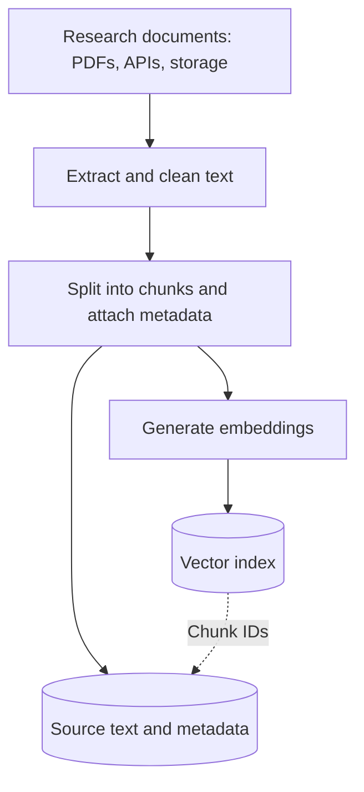
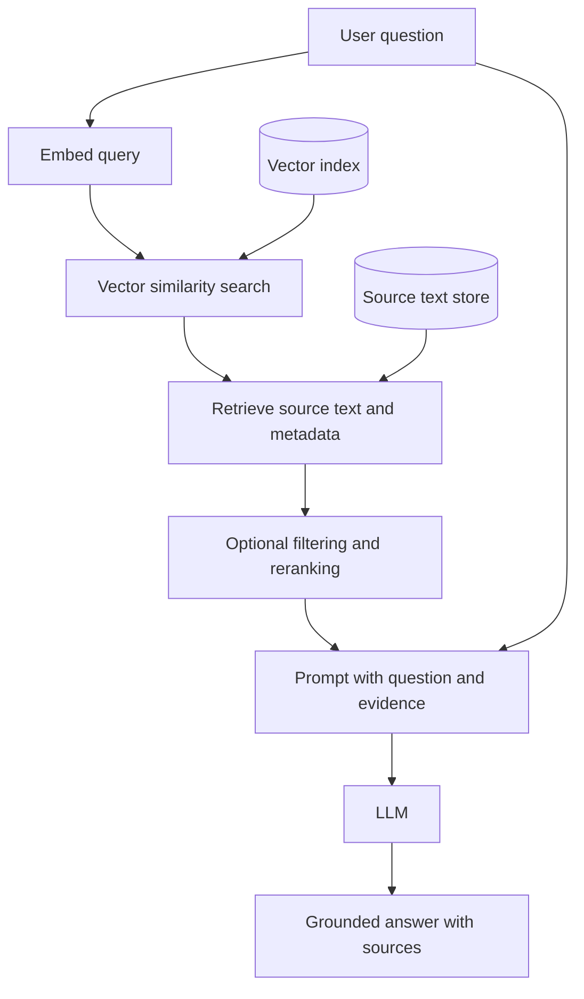
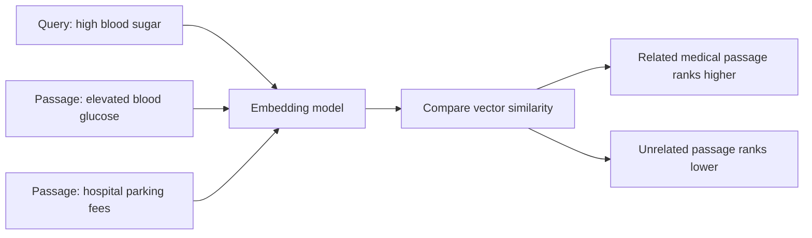
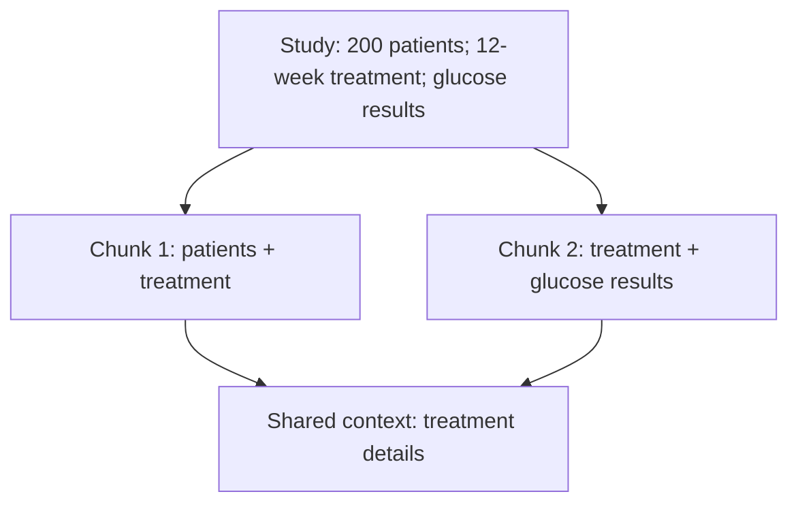
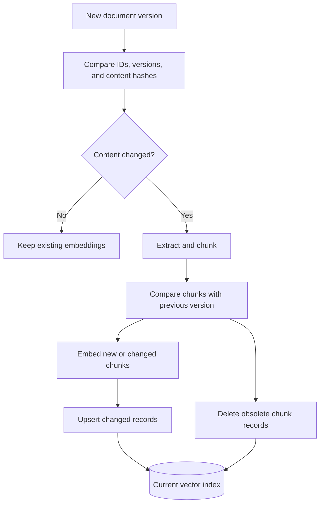
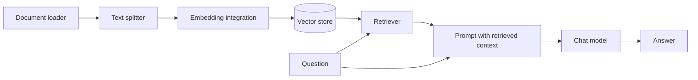

# RAG Fundamentals: Where AI Meets Data Engineering

> **Learning journal · Day 1**  
> Focus: Retrieval-Augmented Generation (RAG), semantic search, and reliable data pipelines.

## 1. The problem

Imagine a research organization with 10,000 clinical-trial documents. Researchers want to ask questions about findings, populations, and outcomes. Sending every document to an LLM for each question is expensive, slow, and may exceed the model's context window. A model's general knowledge also cannot be relied upon to reflect the latest private research documents.

**Retrieval-Augmented Generation (RAG)** addresses this by retrieving a small set of relevant source passages and supplying them to the LLM alongside the question. Retrieval can reduce the context sent to the model, although embedding, indexing, storage, and retrieval also have costs.

## 2. Two pipelines, not one

### Indexing pipeline (when documents arrive or change)

### Query pipeline (when a user asks a question)

**Important:** An embedding is a numerical representation used for retrieval. We also retain the original chunk text (or a reference to it) so the LLM can read the evidence.

## 3. Embeddings and semantic search

Embedding models map text into vectors. Similarity measures such as cosine similarity can rank a query against indexed chunks by vector direction.

For example, *“high blood sugar”* and *“elevated blood glucose”* use different words but have related meanings. A suitable embedding model may place them near each other in vector space.

### Visual intuition: semantic matching

The ranking shown is illustrative: actual results depend on the embedding model and corpus.

**Limitation:** Similarity is not proof of relevance or factual correctness. A chunk about diabetes prevention might rank highly for a diabetes-treatment question without answering it.

## 4. Chunking: a design decision

| Strategy | Strength | Trade-off |
| --- | --- | --- |
| Fixed-size chunks | Simple, predictable, inexpensive baseline | Can split a finding from its explanation |
| Recursive/structure-aware splitting | Respects some paragraph and section boundaries | Boundaries do not always match meaning |
| Semantic chunking | Can group meaningfully related passages | Additional computation and variable chunk sizes |

### Visual intuition: chunk overlap

For clinical research, section-aware or semantic chunking is worth testing, but **there is no universally best chunking strategy**. Evaluate it against representative questions and source documents. Overlap can preserve context across boundaries, but excessive overlap adds cost and duplicate results.

## 5. Incremental indexing: the Data Engineering connection

If 500 new documents arrive each day, rebuilding a million-chunk index nightly is usually wasteful. A better pipeline detects new, changed, and deleted documents and updates only affected records.

### Incremental update flow

A practical design:

1. Assign stable document IDs and track source versions or modification timestamps.
2. Extract and chunk changed documents; compute content hashes for comparison.
3. Reuse embeddings for unchanged chunks when IDs and chunk boundaries remain stable.
4. Embed new or modified chunks and **upsert** them into the vector index.
5. Delete obsolete chunks and retain metadata such as source, version, and update time.
6. Monitor failures, freshness, and partial updates; retry safely.

**Caveat:** A small edit can shift chunk boundaries and change multiple chunks. Stable chunking, versioning, and idempotent updates matter.

## 6. Retrieval quality and grounded answers

Suppose the question is: *“What side effects did elderly patients experience with metformin?”* If retrieval finds only generic metformin studies, the LLM should **not** invent age-specific findings.

Possible improvements include query rewriting, metadata filters, hybrid keyword/vector search, and reranking. If evidence remains insufficient, the answer should clearly say so.

Useful evaluation dimensions:

- **Recall@K:** Does the retrieved set contain the relevant evidence?
- **Precision@K:** What fraction of the retrieved results are relevant?
- **Faithfulness:** Are answer claims supported by the supplied context?
- **Answer relevance:** Does the answer address the actual question?

## 7. Where LangChain fits

LangChain can connect document loaders, text splitters, embedding models, vector stores, retrievers, prompts, and LLMs. It simplifies integration but does **not** automatically guarantee good chunking, accurate retrieval, incremental updates, or grounded answers. Those are engineering responsibilities.

### LangChain component map

This is a conceptual integration map, not a claim that LangChain manages data freshness automatically.

For an initial experiment, a local vector store and a small document collection are sufficient. We can compare retrieval strategies before introducing a hosted LLM.

## 8. Decisions and lessons from Day 1

- Retrieve relevant passages rather than sending an entire document collection to the LLM.
- Preserve both embeddings **and** source text/metadata.
- Test semantic or structure-aware chunking against a simple fixed-size baseline.
- Prefer incremental index updates over full rebuilds when documents change.
- Treat evidence quality as more important than producing a confident-sounding answer.
- Use LangChain as a tool, not as a substitute for understanding the underlying pipeline.

## 9. Next hands-on contribution

Build a minimal LangChain retrieval experiment:

- Load a few sample research passages.
- Split them with a recursive text splitter.
- Create embeddings and index them locally.
- Ask several questions and inspect retrieved chunks and similarity scores.
- Compare chunk sizes and record failure cases.
- Later, add an LLM and a simple incremental update mechanism.

**Guiding principle:** Reliable AI applications start with reliable, maintainable data pipelines.
